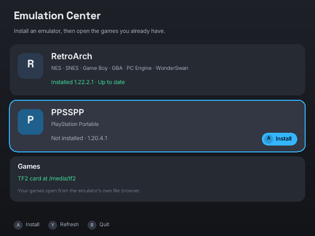
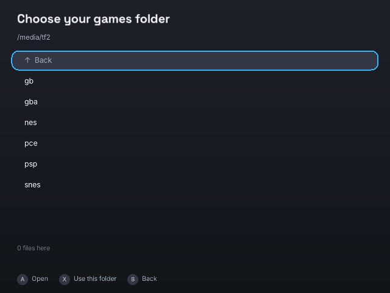

# Emulation Center

Install, update and open emulators on Gizlet handhelds such as the R36S. The center offers RetroArch and PPSSPP, and points them at the games already on the user's TF2 card. It is an ordinary Gizlet app (`io.gizlet.emulation-center`), and so are the emulators: [gizlet/retroarch](https://github.com/gizlet/retroarch) and [gizlet/ppsspp](https://github.com/gizlet/ppsspp). It contains no emulators, games, BIOS files or game artwork, and adds no ROM catalog: players open games they already have in the emulator's own file browser.

| Home | Choosing the games folder |
| --- | --- |
|  |  |

## What it does

| Row | A | X |
| --- | --- | --- |
| RetroArch, PPSSPP | Open the installed emulator, or install it | Update to the Store's newer release |
| Games | Choose a folder | Use the TF2 card again, after choosing another folder |

Y checks the Store again and B quits. Each emulator's row shows the installed version, whether the Store has a newer one, and the download, check and install progress.

- **Installing and updating.** The center asks the Gizlet Store which release suits this device (`GET /v1/gizlets/github.com/gizlet/<emulator>/install`, with the target and tier from `gizlet target`), downloads the package with `curl` into its save folder on the card, resuming a partial download, and checks its size and SHA-256 against the Store's. Only then does `gizlet install` install it, and the download is removed. Before downloading, it checks that the card has room for the package and its unpacked copy. One install runs at a time; the others wait.
- **The TF2 card.** The center reads `/proc/self/mountinfo` and sysfs for a mounted filesystem on an MMC disk other than the one holding the root filesystem, preferring `/media/tf2`, where Gizlet OS mounts the card. When none is mounted, or the user wants another folder, the folder picker browses the TF2 card, `/home`, `/media` and `/mnt`. The chosen folder is kept in `settings.ini` in the save folder; choosing the TF2 card itself follows the card wherever it is mounted.
- **Opening an emulator.** The center writes `open-request` (the emulator's ID and the games folder) in its save folder and exits. The entry script, [`app/emulation-center.sh`](app/emulation-center.sh), then runs `gizlet run <emulator> --games <folder>` in a session of its own and shows the center again when the emulator exits. The emulator's own `gizlet run` ends it when the player holds FN, or Select and Start; if the center is told to stop meanwhile, the script ends the emulator's session first, so the launcher never returns while the emulator still holds the screen.

The center only reads the user's card. The emulators keep their saves and settings in their own save folders.

## Layout

| Path | Holds |
| --- | --- |
| `src/main.rs`, `src/text.rs`, `src/input.rs` | The UI: raylib on the 640×480 panel, the launcher's fonts and colours, the handheld's controls from evdev |
| `src/jobs.rs` | The background worker: what is installed, what the Store offers, installing and updating |
| `src/store.rs`, `src/download.rs`, `src/cli.rs` | The Store API, verified downloads, the `gizlet` command |
| `src/games.rs`, `src/settings.rs` | Finding the TF2 card, the folder picker's places, the chosen folder |
| `src/catalog.rs`, `src/i18n.rs`, `src/version.rs` | The two emulators, English and Simplified Chinese, the Store's version order |
| `app/` | The package's entry: a static launcher (the Store requires an ELF entry) and the script it runs |
| `tests/`, `examples/flow.rs` | The end-to-end test |

## Run on a computer

Requires Rust and CMake (raylib-sys builds a desktop raylib).

```sh
cargo run --release
```

Keys: arrows (D-pad), Enter or K (A), Escape or J (B), I (X), U (Y). Without the `gizlet` command the center shows that it cannot read installed apps; `GIZLET_CLI` names another program. `GIZLET_STORE_API` chooses the Store API, `GIZLET_SAVE_DIR` the save folder (`./save`) and `GIZLET_LANG=zh-CN` Chinese. `EMULATION_CENTER_WINDOW=640x480` sets the window, and `EMULATION_CENTER_CAPTURE=FILE.png` saves one frame once the Store has answered (`EMULATION_CENTER_SCENE=picker` or `picker:DIR`, `EMULATION_CENTER_FOCUS=N`). `EMULATION_CENTER_MOUNTINFO` and `EMULATION_CENTER_SYSFS` replace `/proc/self/mountinfo` and `/sys` for finding the TF2 card. The screenshots above were taken that way on Linux, under Xvfb, with a fixture Store and a mount table presenting `/media/tf2` as an MMC card.

## Build, test and package

On ARM64 Linux with Rust, a C compiler with static glibc, Python 3.11+, libclang and squashfs-tools:

```sh
./scripts/package.sh                 # tests, builds and writes dist/io.gizlet.emulation-center-<version>-aarch64-unknown-linux-gnu-lite.gzl
cargo build --release --locked --no-default-features --example flow
sudo tests/e2e.sh dist/io.gizlet.emulation-center-*.gzl target/release/examples/flow
```

`package.sh` runs the unit tests and links the UI against `libraylib.so.600` from Gizlet runtime 1, taken from the pinned Gizlet OS v0.3.1 release and checked by SHA-256. It also checks that the UI needs no newer glibc than the runtime has. `scripts/ci.sh` does all three steps on GitHub's ARM64 runner.

The end-to-end test uses the real `gizlet` command from the Gizlet OS v0.3.1 Launcher release. It installs the center's package and runs it with `gizlet run`, with [`examples/flow.rs`](examples/flow.rs) standing in for the UI and taking a player's steps through the same code. It installs a RetroArch stand-in from a fixture Store, sees an update published and installs it, and refuses a PPSSPP stand-in whose download fails its checksum. It then chooses a folder on a FAT card image mounted as the user's card, which holds one synthetic file, and opens the emulator there. The test checks that the emulator was opened with that folder, found the file and was updated. The emulator packages in that test are small stand-ins; the real ones are tested in their repositories.

The display, the controls and the real TF2 slot need an R36S to verify.

## Release

Change `version` in [`gizlet.toml`](gizlet.toml) and merge to `main`. CI builds and tests on GitHub's ARM64 runner, publishes the GitHub Release and the Gizlet Store listing, then attaches `NOTICE.md` and the source archive to the release.

## Licenses

Emulation Center is under the MIT License. It uses the launcher's fonts: Inter and Space Grotesk (SIL Open Font License 1.1) and Droid Sans Fallback (Apache License 2.0), whose licenses are in `assets/fonts` and the package's `licenses/`. The icon and cover in `store/` were made for this app.
